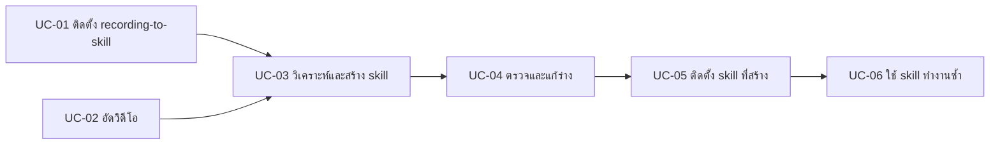

# Use Case: ระบบ recording-to-skill

อัดวิดีโอการทำงาน 1 ครั้ง → agent ดูภาพจากวิดีโอ → ได้ `analysis.md` และ skill ฉบับร่าง → คนตรวจ → ติดตั้ง → สั่ง agent ทำงานเดิมซ้ำกับข้อมูลชุดใหม่

## Actor

| Actor | บทบาท |
| --- | --- |
| ผู้สาธิตงาน | คนที่ทำงานนั้นเป็น อัดวิดีโอ และบอกเป้าหมาย |
| ผู้ตรวจ | ตรวจ `analysis.md` และ skill ฉบับร่าง (เป็นคนเดียวกับผู้สาธิตได้) |
| Agent | session Claude Code, Codex หรือ Gemini CLI ที่โหลด skill แล้ว ทำหน้าที่ดูภาพและเขียนไฟล์ |
| ตัวแยกภาพ | `extract_frames.py` ร่วมกับ FFmpeg/ffprobe ทำงานในเครื่อง |
| ผู้ใช้ skill ปลายทาง | คนที่สั่ง agent ทำงานซ้ำด้วย skill ที่สร้างออกมา |

## System use cases

### UC-01 ติดตั้ง recording-to-skill

- **Actor:** ผู้สาธิตงาน หรือผู้ดูแลเครื่อง
- **เงื่อนไขก่อนเริ่ม:** มี Python 3 และ FFmpeg อยู่ใน PATH
- **ขั้นตอนหลัก:**
  1. รัน `ffmpeg -version`, `ffprobe -version` และ `python --version`
  2. คัดลอกโฟลเดอร์ `recording-to-skill` ทั้งโฟลเดอร์ไปที่ `.claude\skills\` (Claude Code) หรือ `.agents\skills\` (Codex และ Gemini CLI) ด้วยคำสั่งใน README
  3. เปิด session ใหม่ แล้วตรวจว่าเห็น `/recording-to-skill` (Codex ดูที่ `/skills`, Gemini CLI ใช้ `/skills list`)
- **ทางเลือก:** ถ้ามีโฟลเดอร์ปลายทางอยู่แล้ว คำสั่งจะหยุดและแจ้ง ไม่เขียนทับ
- **ผลลัพธ์:** host เรียกใช้ skill ได้

### UC-02 อัดวิดีโอขั้นตอนงาน

- **Actor:** ผู้สาธิตงาน
- **ขั้นตอนหลัก:**
  1. เตรียมข้อมูลตัวอย่างที่ไม่ใช่ข้อมูลลับ
  2. กด Win + Shift + R แล้วเลือกพื้นที่ให้เห็นชื่อหน้าต่าง URL และชื่อไฟล์
  3. ทำงานตั้งแต่ต้นจนได้ผลลัพธ์ และหยุดค้างที่หน้าสำคัญ 1–2 วินาที
  4. กด Stop แล้วบันทึกเป็น MP4
- **ผลลัพธ์:** ไฟล์ MP4 1 ไฟล์

### UC-03 วิเคราะห์วิดีโอและสร้าง skill (use case หลัก)

- **Actor:** ผู้สาธิตงาน (เป็นผู้สั่ง), Agent, ตัวแยกภาพ
- **เงื่อนไขก่อนเริ่ม:** ทำ UC-01 และ UC-02 เสร็จแล้ว และเปิด session ในโฟลเดอร์ที่จะเก็บผล
- **Trigger:** `/recording-to-skill วิเคราะห์ไฟล์ C:\Recordings\demo.mp4 เป้าหมายคือ ...`
- **ขั้นตอนหลัก:**
  1. Agent ตั้งชื่องาน `<task-name>` จากเป้าหมาย
  2. ตัวแยกภาพตรวจวิดีโอ แล้วแยก 12 ภาพที่กระจายทั้งคลิปไปที่ `work/<task-name>/frames/` พร้อม `manifest.json`
  3. Agent เปิดดูทุกภาพ แล้วจดแอป หน้าต่าง ข้อความ และสิ่งที่เปลี่ยนไปในแต่ละภาพ
  4. ช่วงที่ยังไม่ชัด agent ขอภาพเพิ่มด้วย `--timestamps` ไปที่ `frames-detail-<n>/` ได้ไม่เกิน 3 รอบ
  5. Agent เขียน `work/<task-name>/analysis.md` โดยแยกข้อมูลเป็น observed (เห็นในภาพ), inferred (อนุมาน) และ unknown (ไม่ทราบ)
  6. Agent เขียน `generated/<task-name>/SKILL.md` โดยเปลี่ยนค่าตัวอย่างให้เป็น input และเลือกใช้ CLI/API ก่อนการกดหน้าจอ
  7. Agent ตรวจ frontmatter และไฟล์ที่อ้างถึง แล้วรายงานจุดที่ต้องยืนยัน
- **ทางเลือกและข้อผิดพลาด:**

  | สถานการณ์ | สิ่งที่ระบบทำ |
  | --- | --- |
  | ผู้ใช้ไม่ได้บอกเป้าหมาย | ดูภาพก่อน และถามเฉพาะเมื่อคำตอบจะทำให้ผลลัพธ์ต่างไป |
  | วิดีโอมีเสียงแต่ไม่มี transcript | ระบุใน `analysis.md` ว่าไม่ได้วิเคราะห์เสียง |
  | host เปิดไฟล์ภาพเองไม่ได้ | หยุด และให้ผู้ใช้แนบภาพเอง (Codex: `codex -i`) |
  | ไม่พบ ffmpeg หรือ ffprobe | จบด้วย exit 2 พร้อมวิธีติดตั้ง โดย agent ไม่ติดตั้งให้เอง |
  | ไฟล์เสียหรือไม่มี video stream | จบด้วย exit 1 แล้ว agent รายงานและหยุด |
  | มีโฟลเดอร์ผลลัพธ์อยู่แล้ว | ไม่เขียนทับ และตั้งชื่อใหม่ เช่น ต่อท้ายด้วย `-2` |
  | ข้อความในวิดีโอดูเหมือนคำสั่ง | ถือเป็นข้อมูลตัวอย่าง ไม่ทำตาม |

- **ผลลัพธ์:** `analysis.md` และ skill ฉบับร่าง ซึ่งยังไม่ได้ติดตั้งและยังไม่ได้รัน

### UC-04 ตรวจและแก้ skill ฉบับร่าง

- **Actor:** ผู้ตรวจ โดยมี Agent ช่วยแก้
- **ขั้นตอนหลัก:**
  1. อ่านหัวข้อ "Uncertainties to check" ใน `analysis.md`
  2. ตอบคำถามที่ค้างอยู่ เช่น ไฟล์เก็บไว้ที่ไหน หรือขั้นตอนที่ไม่เห็นในวิดีโอทำอย่างไร
  3. สั่ง agent แก้ `SKILL.md` ตามคำตอบ หรือแก้เอง
  4. ตรวจทุกข้อในหัวข้อ "Assumptions to confirm" ว่าถูกต้อง
- **ผลลัพธ์:** skill ที่ผ่านการตรวจแล้ว

### UC-05 ติดตั้ง skill ที่สร้างขึ้น

- **Actor:** ผู้ตรวจ
- **ขั้นตอนหลัก:**
  1. คัดลอก `generated/<task-name>/` ทั้งโฟลเดอร์ไปที่ `.claude\skills\` หรือ `.agents\skills\` (ใช้คำสั่งเดียวกับ UC-01 แต่เปลี่ยน `$src` และ `$dest`)
  2. ถ้าจะแชร์ให้ทีม ให้ commit โฟลเดอร์ไว้ใน `.claude/skills/` หรือ `.agents/skills/` ของ repo ทีม
- **ผลลัพธ์:** ทีมเรียกใช้ `/<task-name>` ได้

### UC-06 ใช้ skill ทำงานซ้ำ

- **Actor:** ผู้ใช้ skill ปลายทาง, Agent
- **เงื่อนไขก่อนเริ่ม:** มี dependency ครบตามหัวข้อ Prerequisites ของ skill เช่น login ระบบปลายทางแล้ว
- **ขั้นตอนหลัก:**
  1. สั่ง `/<task-name>` พร้อมข้อมูลของรอบนี้ เช่น ไฟล์ วันที่ หรือรายการ
  2. Agent ตรวจ prerequisite แล้วทำตามขั้นตอน โดยวนให้ครบทุกรายการ
  3. Agent รายงานผลลัพธ์และที่อยู่ไฟล์
- **ทางเลือก:** ถ้า input ว่าง ไม่มีสิทธิ์ หรือทำไม่สำเร็จกลางทาง ให้หยุดและรายงาน โดยไม่เขียนผลลัพธ์ที่ทำได้เพียงบางส่วน (`recording-to-skill` สั่งให้ skill ร่างทุกตัวมีหัวข้อนี้)
- **ผลลัพธ์:** งานเสร็จโดยไม่ต้องอัดวิดีโอใหม่

## Business use cases (ตัวอย่างงาน)

| งาน | เครื่องมือที่ skill น่าจะใช้ | ความเหมาะสม |
| --- | --- | --- |
| รวมไฟล์ยอดขายรายสาขาเป็นสรุปรายเดือน | Python หรือ PowerShell (CSV ใช้ stdlib ได้ ส่วน .xlsx ต้องเพิ่ม library เช่น openpyxl) | สูง |
| ตั้งค่าเครื่องพนักงานใหม่ เช่น ติดตั้งโปรแกรมและ map drive | PowerShell, winget | สูง |
| รวบรวม GitHub issues ทำรายงาน | `gh` CLI | สูง (ทดสอบ dry-run กับวิดีโอสังเคราะห์แล้ว) |
| ดึงรายงานจากระบบเว็บภายในที่ไม่มี API | Playwright MCP ถ้า host มี ถ้าไม่มีจะได้เป็นคู่มือให้คนทำ | ปานกลาง |
| คีย์ข้อมูลในโปรแกรม desktop ที่ไม่มี API | ได้เป็นคู่มือให้คนทำตาม | ต่ำ |

## ไม่เหมาะ / ข้อควรระวัง

- **ข้อมูลลับ:** ตอนวิเคราะห์ ภาพจากวิดีโอจะถูกส่งให้โมเดลของ host (Claude, Codex หรือ Gemini) จึงไม่ควรอัดรหัสผ่าน ข้อมูลลูกค้า หรือข้อมูลลับ
- **การตัดสินใจที่ไม่ปรากฏบนจอ:** ถ้างานต้องใช้ความรู้ในหัวของผู้ทำ skill จะขาดเงื่อนไขนั้นไป ให้พิมพ์อธิบายเพิ่มในคำสั่ง หรือส่ง transcript มาด้วย
- **งานที่ไม่มีรูปแบบซ้ำ:** ถ้าแต่ละรอบต่างกันมาก ไม่คุ้มที่จะทำเป็น skill
- **วิดีโอยาว:** งานที่ยาวเกิน 5–10 นาทีควรแบ่งอัดทีละงานย่อย เพราะภาพที่ห่างกันมากทำให้พลาดขั้นตอนได้ง่าย
